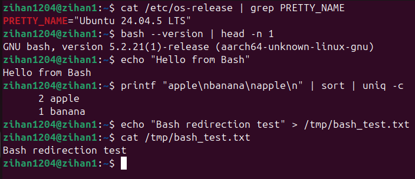
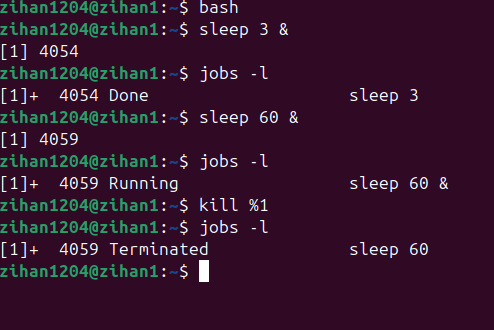
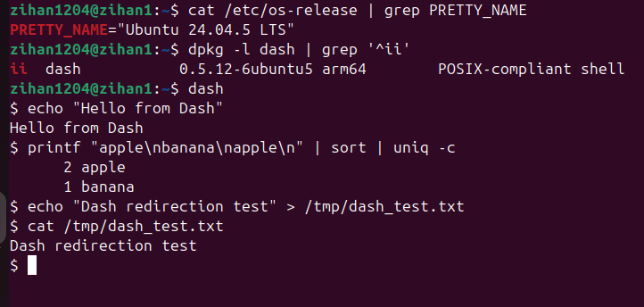
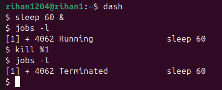
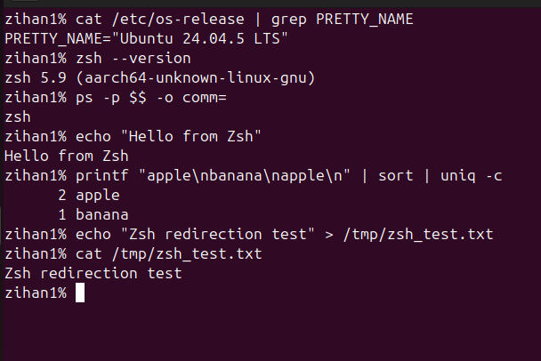
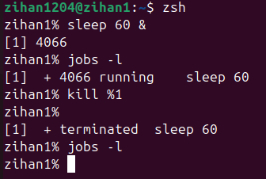
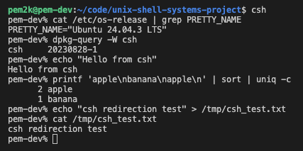
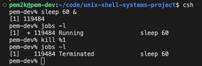

# Preliminary Exploration Report

## Project G.2: UNIX Shell

### 1. Introduction

The goal of this exploration is to study existing UNIX shell implementations before designing our own shell.

We selected four shells for comparison: Bash, Dash, Zsh, and CSH. All were tested on an Ubuntu LTS virtual machine.

We focused on basic command execution, pipelines, output redirection, and background process management.

These features are important for our project because we plan to build a UNIX shell with a priority-based batch scheduling extension.

By comparing existing shells, we want to understand how they handle processes and identify which features and mechanisms we should consider in our own implementation.

### 2. Experimental Environment

- Operating System: Ubuntu 24.04.5
- Shell 1: GNU Bash 5.2.21
- Shell 2: Dash 0.5.12-6ubuntu5
- Shell 3: Zsh 5.9
- Shell 4: CSH  20230828-1 (no --version available)

### 2.1 Historical and Design Context

Before analyzing each shell's behavior, it is useful to understand why these shells exist and what design goals they pursue.

Bash (Bourne-Again Shell) was created by the GNU Project in 1989 [1]. It extends the original Bourne shell (sh) with scripting features, command-line editing, and job control. Bash is the default shell on most Linux distributions. Its design priority is broad functionality and backward compatibility.

Dash (Debian Almquist Shell) is derived from the Almquist shell [2]. Debian adopted Dash as the default system shell (/bin/sh) because of its small size and fast startup time [2]. Dash is designed to run POSIX shell scripts efficiently. It intentionally avoids interactive features.

Zsh (Z Shell) was created at Princeton University in 1990 [3]. It combines features from Bash, Korn Shell (ksh), and tcsh. Zsh focuses on interactive use. It provides advanced completion, spell correction, and plugin support. Zsh is the default shell on macOS since Catalina.

CSH (C Shell) was developed in the late 1970s at UC Berkeley [5]. At the time it included features SH didn't such as command history, the ability to edit within the command line, and aliases. It was intended to make using the command line easier with a familiar C like syntax, per the creator William Joy, "It incorporates good features of other shells and a history mechanism similar to the redo of INTERLISP. While incorporating many features of other shells which make writing shell programs, easier, most of the features unique to csh are designed more for the interactive UNIX user" [5].

These design goals explain the differences we observed in our experiments. Bash balances features and compatibility. Dash prioritizes size and startup speed. CSH and Zsh prioritize interactive user experience.

### 3. Existing Shell Implementations

#### 3.1 GNU Bash

Bash is a widely used UNIX shell that supports command execution, pipelines, redirection, scripting, and job control.

In our experiments, Bash successfully executed basic commands, processed a multi-stage pipeline, and redirected output to a file.

We also tested background process management using `sleep 60 &`, `jobs -l`, and `kill %1`.

Bash allowed us to start a background process, check its running status, and terminate it.

#### 3.2 Dash

Dash is a lightweight POSIX-compatible shell commonly used for system scripts.

Our tests showed that Dash supports basic command execution, pipelines, and output redirection.

Dash also successfully handled background processes. We were able to start a background job, view its status using `jobs -l`, and terminate it using `kill %1`.

This shows that even a lightweight shell can provide basic process management features.

#### 3.3 Zsh

Zsh is a UNIX shell that provides scripting capabilities and advanced interactive features.

In our experiments, Zsh successfully executed basic commands, pipelines, and output redirection.

We also tested its background job management.

Zsh allowed us to start a background process and inspect its status. After terminating the process, Zsh displayed a termination notification.

This behavior was slightly different from what we observed in Bash and Dash.

#### 3.4 CSH

CSH is a UNIX shell that provides both scripting and interactive features. Although older than the other shells presented, it still executes basic commands, pipes, and redirection, all of which can be seen in both its successor TCSH (not explored here), as well as in zsh. Importantly, CSH is not POSIX compliant [4], it lacks file descriptors [4], and contains command parsing bugs [4] among other issues.

### 4. Experimental Screenshots

All screenshots were captured while running the shells
on an Ubuntu virtual machine.

#### 4.1 Bash

Basic command execution, pipelines, and redirection:

Background process management:

#### 4.2 Dash

Basic command execution, pipelines, and redirection:

Background process management:

#### 4.3 Zsh

Basic command execution, pipelines, and redirection:

Background process management:

#### 4.4 CSH

Basic command execution, pipelines, and redirection:

Background process management:

### 5. Comparative Analysis

We compared Bash, Dash, Zsh, and CSH across three dimensions: functional behavior, design philosophy, and process management mechanisms.

The functional comparison appears in the table below. All shells support the core features we tested. The real differences between them are not in what they can do, but in how they do it and why.

| Feature | Bash | Dash | Zsh | CSH |
|---------|------|------|-----|-----|
| Basic command execution | Supported | Supported | Supported | Supported |
| Pipelines | Supported | Supported | Supported | Supported |
| Output redirection | Supported | Supported | Supported | Supported |
| Background processes | Supported | Supported | Supported | Supported |
| Job status inspection | Supported | Supported | Supported | Supported |
| Job termination | Supported | Supported | Supported | Supported |

#### 5.0 Beyond the Feature Table

The table shows that all shells support the same core features. This is misleading if read alone. The important differences are hidden behind these "Supported" entries.

For example, all shells support background processes. However:

- Bash maintains a complete job table and provides commands like `fg`, `bg`, `jobs`, `disown`, and `wait`. It supports process groups and terminal control.
- Dash supports background jobs but with a minimal implementation. Dash focuses on script execution, not on interactive job management.
- Zsh extends Bash's job control model with additional notification features. It can display asynchronous completion messages mid-prompt.
- CSH supports background and foreground jobs, keeping an internal table like the other shells that process based commands can read and manipulate. Notably, CSH doesn't support disown [5], meaning jobs are stuck running until they complete, crash, or are terminated. In contrast, Bash offers explicit control, allowing a job to be removed from the internal table without terminating the process.

Our project will implement background process execution. These observations tell us that the depth of job control is a design decision, not a binary feature. We will implement a minimal but functional job control system similar to Dash's approach.

#### 5.1 Bash

Bash provides a good balance between functionality and usability.

Its job control features allow users to start, monitor, and
terminate background processes.

However, Bash includes many additional features that would
make a complete reimplementation too complicated for our project.

#### 5.2 Dash

Dash has a simpler design and focuses on POSIX shell functionality.

Its lightweight implementation makes it a useful reference
for understanding basic command execution and process management.

However, Dash provides fewer interactive features than Bash
and Zsh.

#### 5.3 Zsh

Zsh provides advanced interactive functionality and flexible
process management.

Our experiments showed that Zsh reports background job
termination clearly.

However, its additional interactive features increase
implementation complexity.

#### 5.4 CSH

CSH completed our tests for basic command executions.

While it was designed with interactivity in mind and worked as intended,
its differences and bugs make it unsuitable for standard usage.

In connection to our project, this shell's implementation of process management
is more relevant than its syntax differences.

#### 5.5 Trade-off Analysis

Each shell makes a trade-off between size, startup speed, feature richness, and interactive quality.

Dash trades features for size and speed. Its small binary and minimal feature set make it fast to start. This is why Debian uses it for shell scripts in system boot sequences, where startup latency matters [6].

Bash trades startup speed and size for feature breadth. Bash supports arrays, associative arrays, process substitution, extended globbing, and many built-in commands. Each feature adds code and startup overhead.

Zsh trades simplicity for interactive quality. Zsh's completion system can complete command arguments based on each command's documented options. This power comes from a complex configuration system and plugin ecosystem.

CSH occupies an odd spot in our analysis; it's less feature rich than the Bourne Shell variants, contains well documented bugs, and was succeeded by TCSH where many of the bugs were fixed, but it is still not POSIX compliant, and would fail when presented with any portable scripts from POSIX systems. The lack of standardization makes it less useful in today's environments where many machines with different configurations may be running the same script, and overall it seems like a relic compared to the other shells presented.

For our project, the relevant lesson is that we must choose where our shell sits on this spectrum. Because our research extension is a batch scheduler, we prioritize predictable process management and clean benchmarking. We do not need advanced interactive features. Our design will be closer to Dash in interactive scope and closer to Bash in process management depth.

#### 5.6 Process Management Mechanisms

All shells rely on similar UNIX system calls for process management: `fork()`, `exec()` variants, and `wait()` variants. This is the foundation we will also use for our shell.

The differences appear in how each shell organizes these calls:

- Bash uses a central dispatch function that distinguishes between simple commands, pipelines, and compound commands. It builds a job structure for every launched process group and tracks state transitions.
- Dash uses a simpler model. It executes commands with less bookkeeping. This reduces code complexity but limits features such as `fg` / `bg`.
- Zsh adds additional hooks around process creation and termination. These hooks support features such as auto-notification of completed jobs.

These architectural differences do not change the system-call primitives. They change the data structures that surround the primitives. For our shell, we will keep the data structures minimal in Sprint 2, then extend them with a job queue in Sprint 3 to support priority scheduling.

### 6. Connection to Our Project

Our project will implement a UNIX shell based on the
fundamental process management mechanisms observed in
these existing implementations.

The standard shell will support:

- Basic command execution
- Process creation using fork()
- Program execution using exec()
- Process synchronization using wait()
- Input and output redirection
- Pipelines
- Background process execution

Our research extension will introduce priority-based
batch scheduling.

Instead of executing all submitted batch jobs using
the same scheduling policy, our shell will maintain
a priority-based job queue.

The scheduler will select jobs based on their assigned
priority levels.

We plan to evaluate the extension by comparing
job waiting time, turnaround time, and response time
under different workloads.

### 7. Conclusion

This exploration helped us understand the basic
functionality and process management features of
four existing UNIX shells.

Bash demonstrates practical job control,
Dash provides a lightweight implementation,
Zsh offers advanced interactive functionality,
and CSH illustrates an early approach to job management
and interactive features.

All shells successfully completed our
basic command execution, pipeline, redirection,
and background process experiments.

These observations will guide the design of
our UNIX shell and its priority-based batch
scheduling extension.

### 8. Bibliography

[1] FASRC. 2024. Bash. Harvard University FAS Research Computing. Retrieved from https://docs.rc.fas.harvard.edu/kb/bash/
[2] Arch Wiki. 2025. Dash. ArchWiki. Retrieved from https://wiki.archlinux.org/title/Dash
[3] Linux Command Library. 2025. zsh - The Z Shell. Retrieved from https://linuxcommandlibrary.com/man/zsh
[4] Arnaud Taddei. 1994. Shell Choice: A Shell Comparison. CN/DCI/162. Retrieved from https://www.hep.phy.cam.ac.uk/lhcb/LHCbSoftTraining/documents/ShellChoice.pdf
[5] William Joy. 1979. An Introduction to the C Shell. Computer Science Division, Department of Electrical Engineering and Computer Science, University of California, Berkeley. Retrieved from https://docs-archive.freebsd.org/44doc/usd/04.csh/paper.pdf
[6] Debian. 2025. dash(1). Debian Manpages. Retrieved from https://manpages.debian.org/testing/dash/dash.1.en.html

